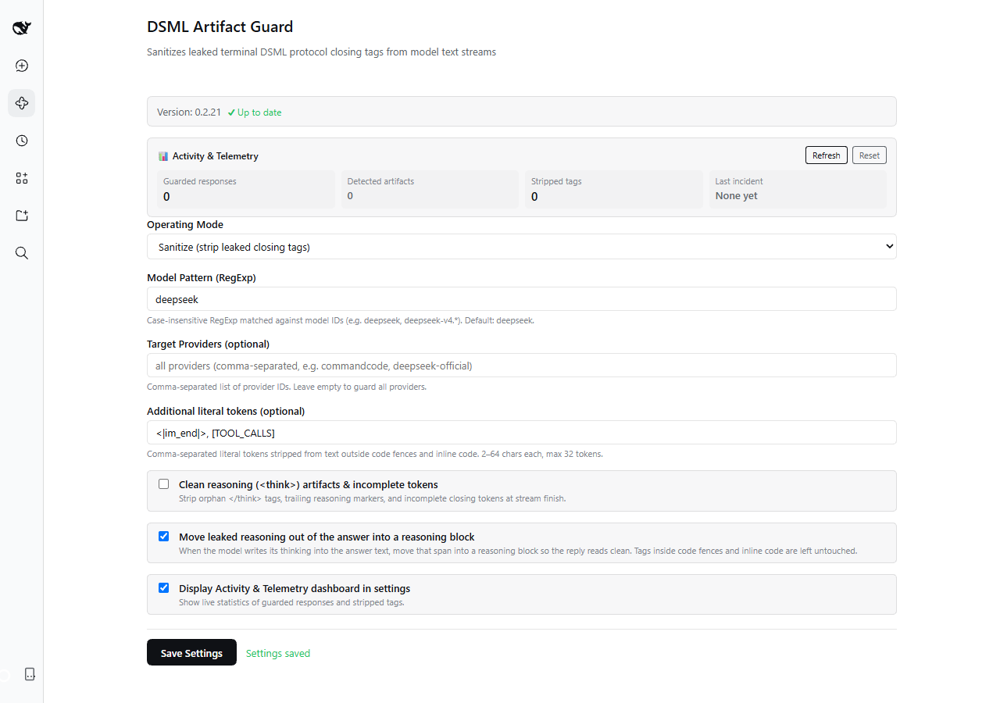

# 📦 @goodandready/dsh-dsml-artifact-guard

<div align="center">

<h3>零依赖流式防护与清理插件：拦截 DeepSeek DSML 协议泄漏闭合标签及思维链残留标记</h3>

<p align="center">
  <a href="https://www.npmjs.com/package/@goodandready/dsh-dsml-artifact-guard"></a>
  <a href="LICENSE"></a>
  <a href="https://github.com/topics/dsh-plugin"></a>
  <a href="https://nodejs.org"></a>
</p>

<p align="center">
  <a href="https://goodandready.app/"></a>
</p>

<p align="center">
  <a href="README.md"><b>🇬🇧 English</b></a> •
  <a href="README.ru.md"><b>🇷🇺 Русский</b></a> •
  <a href="README.zh.md"><b>🇨🇳 中文说明</b></a>
</p>

<table align="center">
  <tr>
    <td align="center">
      ⭐ <strong>如果这个插件对您有所帮助，请在 GitHub 上点亮 Star</strong> — 您的支持将激励我持续维护与完善。
      <br><br>
      🐛 <strong>发现缺陷或有功能建议？</strong> 欢迎在 GitHub 提交 Issue。
    </td>
  </tr>
</table>

</div>

---

## ⚡ 解决的问题与功能亮点

在通过第三方代理网关调用 DeepSeek 模型时，工具调用协议（DSML — DeepSeek Markup Language）的闭合标签有时会泄漏至可见文本流中：

```text
任务已完成。
</｜DSML｜parameter> </｜DSML｜invoke> </｜DSML｜tool_calls>
```

匹配器支持标签内的水平空格、`calls` / `tool-calls` 别名以及 ASCII 竖线 `|`，因此同一模型家族产生的变体同样会被清理。

此外，推理模型（如 DeepSeek-R1 / V3）在异常中断时可能残留游离的 `</think>` 标签、末端标记或未闭合的思维块，破坏 Markdown 排版。

**`@goodandready/dsh-dsml-artifact-guard`** 实时拦截并清洗这些协议残留物：

1. **严格同步钩子契约**：同步实现 `llm/stream` 钩子，直接返回 `AsyncIterable`，避免异步 Promise 导致的崩溃。
2. **分片边界滑动窗口**：通过 96 字节滑动窗口完整捕获跨网络分片截断的闭合标签。
3. **连接异常中断残缺清理**：流收到 `finish` 信号时自动剥离残缺的协议前缀（如 `</｜DSML｜...`）。
4. **思维链标记防护 (`cleanThinkArtifacts`)**：清理孤立的 `</think>` 标签、末端思维标记，并在流中断时自动修复未闭合的思维块。
5. **思考迁移 (`salvageReasoning`)**：模型把思考过程写进正文而不是 reasoning 通道时，将这一段搬进 reasoning 区块，正文回复保持干净；代码围栏与行内代码不动。默认关闭。
6. **标签平衡与故障开放**：追踪开闭标签平衡，技术讨论中的合法 DSML 样例绝不被误删。
7. **实时遥测与拦截统计面板**：在 Web UI 设置卡片中直观展示已防护应答数、剥除标签数、最近拦截记录与重置操作。

---

## 📦 快速安装

通过 DeepSeek Harness CLI 一键安装：

```bash
dsh plugin --profile web add @goodandready/dsh-dsml-artifact-guard
```

重启 DeepSeek Harness 实例即可生效。

---

## ✅ 运行要求

- Node.js 20 或更高版本。
- DeepSeek Harness `>=0.1.7`，需支持同步 `llm/stream` 钩子与 SettingsForms。

---

## ⚙️ 配置指南 (`settings.yaml`)

在 `settings.yaml` 或 Web UI 设置面板中配置规则：

```yaml
# settings.yaml
dsh-dsml-artifact-guard:
  mode: sanitize
  modelPattern: "deepseek"
  providers: []
  customTokens: []
  cleanThinkArtifacts: false
  salvageReasoning: false
  showTelemetry: true
```

### 配置参数参考表

| 参数名 | 类型 | 默认值 | 功能说明 |
|:---|:---|:---|:---|
| `mode` | `string` | `"sanitize"` | 运行模式：`"sanitize"`（清洗标签）、`"audit"`（仅审计）或 `"disabled"` |
| `modelPattern` | `string` | `"deepseek"` | 不区分大小写的模型正则匹配式（默认：`"deepseek"`） |
| `providers` | `string[]` | `[]` | 目标服务商列表。为空时防护全部服务商 |
| `customTokens` | `string[]` | `[]` | 附加字面量标记：仅在代码块与行内代码之外移除（每个 2–64 个字符，最多 32 个），例如 `<|im_end|>`、`[TOOL_CALLS]`、`<|eot_id|>` |
| `cleanThinkArtifacts` | `boolean` | `false` | 剥除游离 `</think>` 标签、末端思维标记并修复未闭合思维块 |
| `salvageReasoning` | `boolean` | `false` | 模型把思考写进正文时，将这段内容迁到 reasoning 通道，正文不再夹杂推理；代码围栏与行内代码内的内容原样保留。默认关闭 |
| `showTelemetry` | `boolean` | `true` | 是否在设置卡片中显示活动与遥测仪表盘 |
| `providerId` | `string` | `undefined` | *(已弃用)* 目标服务商标识符；保留用于向后兼容 |
| `modelId` | `string` | `undefined` | *(已弃用)* 目标模型标识符；保留用于向后兼容 |

### HTTP 管理接口

| 方法 | 接口路径 | 访问权限 | 说明 |
|:---|:---|:---|:---|
| `GET` | `/api/dsh-dsml-artifact-guard/stats` | Web UI / Localhost | 获取实时拦截遥测与最近事件列表 |
| `POST` | `/api/dsh-dsml-artifact-guard/stats` | Loopback & Same-Origin | 重置遥测计数器并清空最近事件 |
| `GET` | `/api/dsh-dsml-artifact-guard/update` | Web UI / Localhost | 检查当前版本与最新版本状态 |
| `POST` | `/api/dsh-dsml-artifact-guard/update` | Loopback & Same-Origin | 执行原地热更新 |

---

## 🖼️ 视觉验证



设置卡片提供守卫运行状态、运行模式切换、活动与遥测仪表盘及拦截记录、无障碍表单控件以及一键式就地升级。

---

## 🧪 测试与校验

运行全部自动化测试与语法检查：

```bash
npm test
npm run check
```

---

## 📄 开源许可证

MIT © [GooDAnDReaDY](https://github.com/GooDAnDReaDY)
